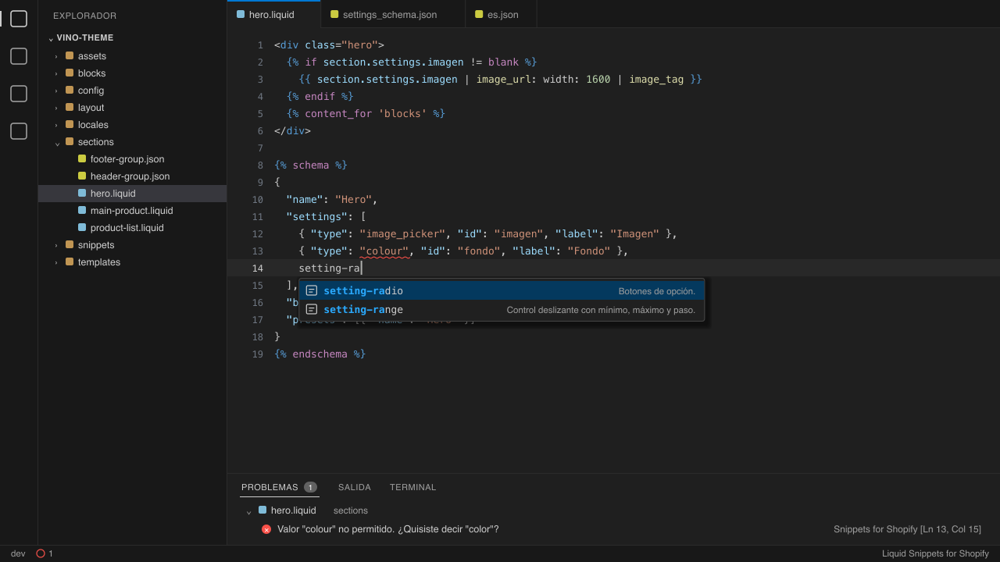

# Snippets for Shopify

**Snippets de Liquid y validación del `` para temas de Shopify, generados desde la documentación oficial.**

Extensión de VS Code para quien construye temas de Shopify (Online Store 2.0 y Horizon): las tags y los filtros de
Liquid como snippets, la estructura de sections y bloques con su ``, un snippet por cada tipo de setting
del editor de temas, y la validación del `` contra el esquema oficial de Shopify mientras escribes.

[](https://marketplace.visualstudio.com/items?itemName=commenteme.shopify-snippets)
[](https://marketplace.visualstudio.com/items?itemName=commenteme.shopify-snippets)
[](./LICENSE)



Versión del código: **0.1.2**, según [package.json](package.json). Requiere **VS Code >= 1.60.0**.

---

## Por qué otra extensión

Todo lo que sugiere sale de los datos oficiales de Shopify
([Shopify/theme-liquid-docs](https://github.com/Shopify/theme-liquid-docs)), fijados en un commit en
[data/fonte.json](data/fonte.json), y cada pieza tiene un test:

- **Ninguna tag ni filtro se queda afuera**: si Shopify agrega uno, el test falla hasta que el snippet exista.
- **Los descontinuados no se sugieren** (`include` y los filtros marcados como `deprecated`).
- **Cada snippet de setting es válido**: los 35 tipos del esquema oficial están cubiertos, y cada ejemplo pasa la
  validación del propio esquema.
- **La validación no da falsos positivos**: se prueba contra todas las sections y bloques de un tema Horizon real.

## Instalación

Desde el VS Code Marketplace: busca **«Snippets for Shopify»**, o desde Quick Open (`Cmd/Ctrl + P`):

```
ext install commenteme.shopify-snippets
```

Desde el terminal:

```bash
code --install-extension commenteme.shopify-snippets
```

## Uso

### Tags y filtros de Liquid

En cualquier `.liquid`, escribe el nombre de la tag (`if`, `for`, `paginate`, `form`, `render`, `content_for`...) o,
después de un `|`, el nombre del filtro (`image_url`, `money`, `where`...). Cada snippet trae el resumen oficial y
el enlace a shopify.dev.

| Prefijo | Qué inserta |
| :--- | :--- |
| `if`, `for`, `case`, `paginate`... | La tag con sus partes editables, en el orden del Tab |
| `content_for` | Dos formas: los bloques del editor o un bloque estático |
| `image_url`, `append`, `where`... | El filtro con sus parámetros |

### Sections y bloques

| Prefijo | Qué inserta |
| :--- | :--- |
| `section-file` | Section completa: bloques del tema, `` y `` con preset |
| `block-file` | Bloque del tema: ``, `block.shopify_attributes` y `` con preset |
| `schema-section` | Solo el `` de una section |
| `schema-block` | Solo el `` de un bloque |
| `preset` | Una entrada de `presets` |
| `blocks-theme` | `"blocks": [{ "type": "@theme" }, { "type": "@app" }]` |
| `image-responsive` | Imagen con `srcset`, `sizes` y `loading: 'lazy'` |
| `shopify-attributes` | `{{ block.shopify_attributes }}` |
| `t-default` | Texto traducido desde `locales` |

### Settings del editor de temas

`setting-<tipo>` inserta un setting válido de ese tipo, en Liquid (dentro del ``) y en JSON
(`config/settings_schema.json`): `setting-text`, `setting-range`, `setting-select`, `setting-color_scheme`,
`setting-image_picker`, `setting-product_list`, `setting-header`... los 35 tipos.

### Validación

- **`` de `sections/*.liquid` y `blocks/*.liquid`**: los errores aparecen subrayados en el lugar exacto,
  en español (propiedad que falta, propiedad que sobra, tipo de setting inexistente, JSON mal formado). Cuando un
  valor no está entre las opciones, sugiere la más cercana: `"colour"` → *¿Quisiste decir "color"?*
- **`config/settings_schema.json` y `locales/*.json`**: con el validador de JSON del propio VS Code.

## Configuración

| Ajuste | Por defecto | Qué hace |
| :--- | :--- | :--- |
| `shopifySnippets.validarSchema` | `true` | Valida el `` de `sections/*.liquid` y `blocks/*.liquid` |

No tiene comandos.

## Junto con otras extensiones

No colorea la sintaxis de Liquid: registra el lenguaje `liquid` para los snippets y la validación, y convive con
cualquier extensión que traiga la gramática, como la oficial de Shopify.

## Solución de problemas

**El Liquid aparece sin colores.** Esta extensión no trae la gramática: instala una que la traiga, como la oficial de
Shopify.

**No aparece ningún error en el ``.** Solo se validan los archivos de `sections/` y `blocks/`, y solo con
`shopifySnippets.validarSchema` encendido.

**`Ctrl + Espacio` no abre las sugerencias (macOS).** macOS usa ese atajo para cambiar la fuente de entrada. Usa
`Cmd + I`, o libéralo en **Ajustes del Sistema → Teclado → Atajos de teclado → Fuentes de entrada**.

## Estructura

```
.
├── extension.js                  # activate()/deactivate(), snippets y validación
├── language-configuration.json   # comentarios y pares del lenguaje liquid
├── lib/                          # lógica pura, sin la API vscode (testeable con node:test)
├── data/                         # tags, filtros y objetos de Shopify, y el commit de origen (fonte.json)
├── schemas/                      # esquema oficial del 
├── snippets/                     # .code-snippets (generado desde data/)
├── images/                       # ícono (PNG y SVG) e imagen del README
├── scripts/                      # sincronizar los datos, generar snippets, ícono, imagen y hooks
└── test/                         # node:test
```

## Desarrollo

JavaScript puro, sin TypeScript y sin build: el `main` es `extension.js`, tipado con JSDoc y `// @ts-check`. CommonJS,
tabs, con punto y coma y con comillas dobles. Dependencias de runtime: `ajv` y `jsonc-parser`.

```bash
git clone https://github.com/zeluizr/shopify-snippets.git
cd shopify-snippets
npm install

npm run check                     # regenera los snippets, falla si cambiaron, y corre los tests
node scripts/sincronizar.js <commit>   # baja datos y esquemas de Shopify/theme-liquid-docs
npm run gerar                     # regenera snippets/ desde data/
npm run icone                     # regenera images/icon.png desde images/icon.svg
npm run preview                   # regenera images/preview.png
npm run empacotar                 # genera el .vsix
```

`F5` en VS Code abre una ventana de desarrollo con la extensión cargada. Con `SHOPIFY_TEMA=/ruta/del/tema node --test`
los tests validan también todas las sections y bloques de un tema real.

**Lo generado nunca se edita a mano.** Los snippets salen de `data/` con `scripts/gerar.js`, y `npm run check` falla
si lo commiteado no es exactamente lo que produce.

**Ramas y publicación.** El trabajo sale de `dev` y llega por pull request; `dev → qa → main` por merge de la rama
entera, y el commit de `main` lleva tag anotada de versión. `./scripts/instalar-hooks.sh` activa los hooks que
cobran lo mismo en local. Una tag `v*` en `main` empaqueta el `.vsix` y lo adjunta a la Release de GitHub. La
publicación en el Marketplace es manual, desde `main`, con `npx @vscode/vsce publish`: sube la versión en
`package.json` y cierra el `CHANGELOG.md` antes, porque el Marketplace rechaza una versión repetida.

Conventional Commits; el mensaje describe el efecto, no el cambio.

## Licencia

MIT, ver [LICENSE](LICENSE). Los datos y esquemas de `data/` y `schemas/` son de Shopify, también MIT: ver
[NOTICE](NOTICE).

---

_Hecho con amor y café por [commente.me](https://commente.me)_
